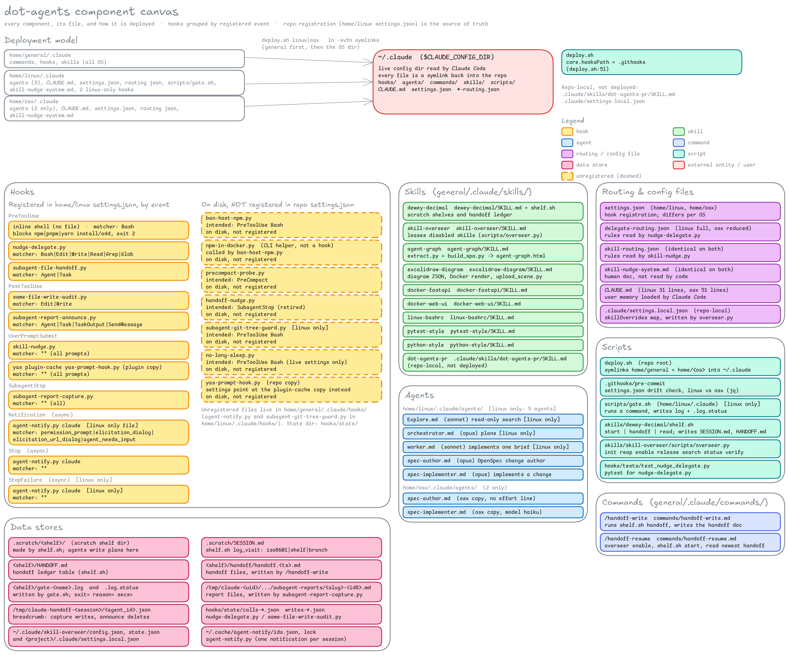
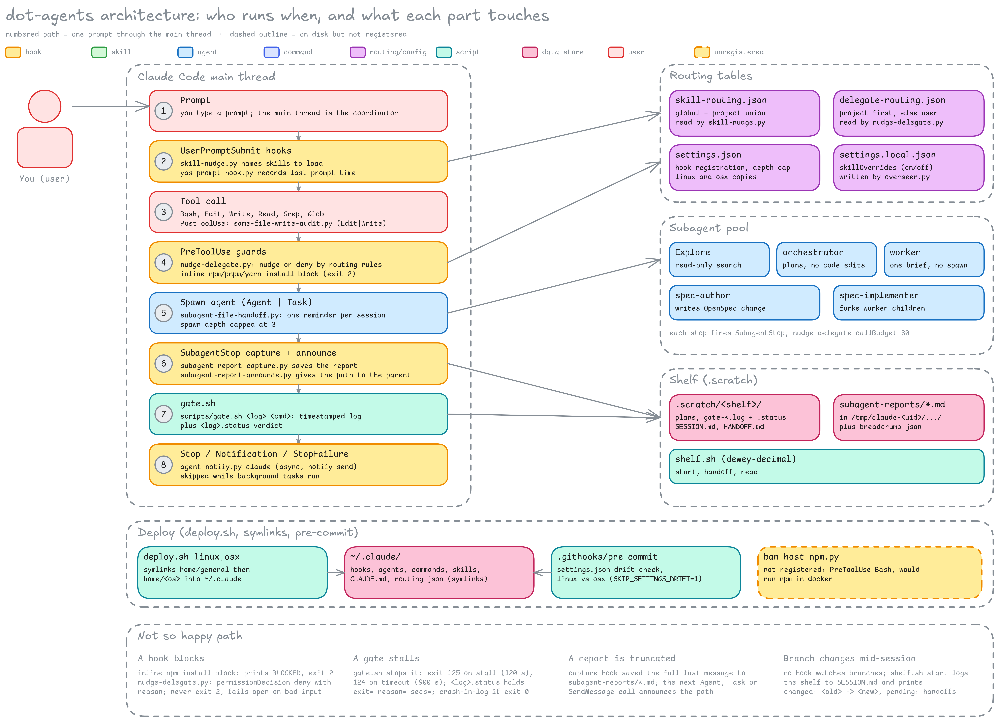
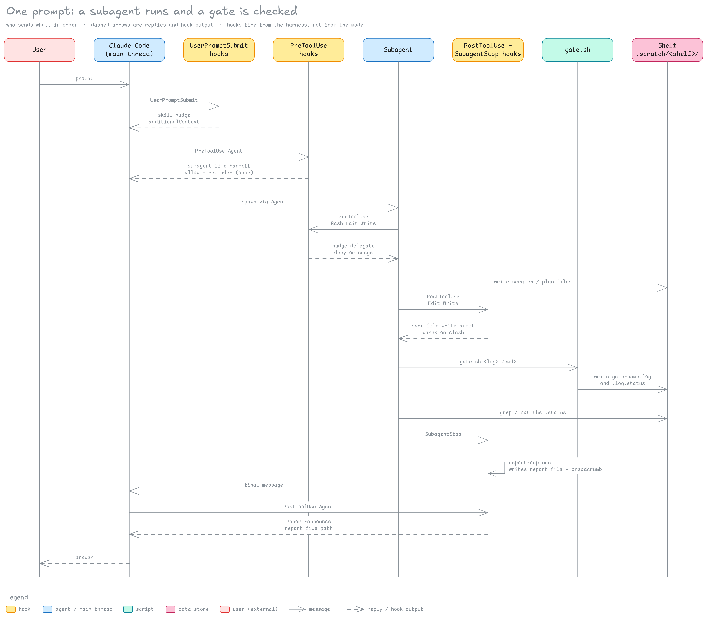
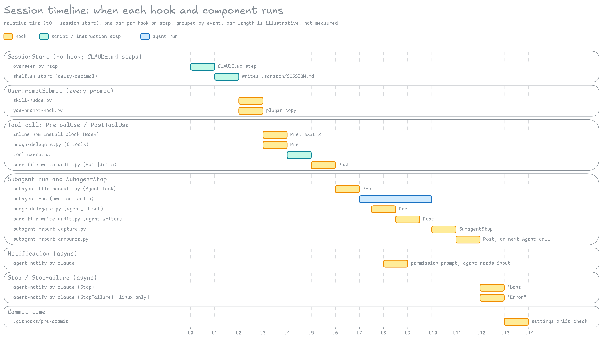

# dot-agents

agentic dotfiles: scripts, hooks, skills &amp; agent definitions

Everything that used to live under `.claude/` in
[tmck-code/dotfiles](https://github.com/tmck-code/dotfiles) now lives here.

## Layout

```
home/general/.claude/   shared on every machine: commands, hooks, skills
home/linux/.claude/     linux-only: agents, CLAUDE.md, settings.json, routing tables, scripts
home/osx/.claude/       macOS-only: same set as linux, with OS-specific settings
```

`home/<os>/.claude/<path>` is symlinked to `$CLAUDE_CONFIG_DIR/<path>`
(default `~/.claude/<path>`).

## Install

```
./deploy.sh linux
./deploy.sh osx
CLAUDE_CONFIG_DIR=~/.claude.personal ./deploy.sh osx
```

`deploy.sh` also sets `core.hooksPath` to `.githooks`, which installs a
pre-commit check that fails if the linux and osx `settings.json` drift apart
(bypass with `SKIP_SETTINGS_DRIFT=1`).

## Docs

  - [Skill nudge system](home/linux/.claude/skill-nudge-system.md)
  - [Hook canvas](docs/hooks-canvas.png): the four locally-written hooks, what they do and what they write

All diagrams below share one colour legend.

### Component canvas

Shows every hook (grouped by event, unregistered ones dashed), skill, agent, command, routing and config file, script and data store, with the deployment model on top.



### Architecture

Shows the main-thread steps numbered 1 to 8. Side regions cover subagents, the shelf, routing tables and deploy. It also shows failure cases.



### Session sequence

Shows the messages for one prompt that spawns a subagent and runs a gate.



### Session gantt

Shows the order in which hooks and scripts run during a session, on a relative time axis.



### Interaction flowchart

Shows which files register, read, name or write which other files. It has one decision, for nudge-delegate.


### Data flow

Shows processes (hooks, scripts, skills), data stores with their paths, and external entities (User, Claude Code runtime, git, GitHub, Excalidraw+).


