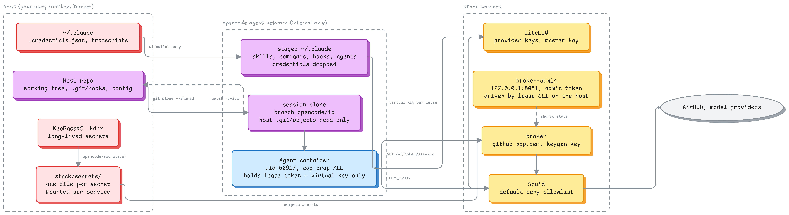

# OpenCode dev image

A Debian bookworm image for running [OpenCode](https://opencode.ai) v2 against
a bind-mounted repo, with the tooling agents expect: git, a full C toolchain,
Node.js/npm, and Python managed by uv.

| Component | Version |
|---|---|
| OpenCode | 2.1.4 (official v2 installer) |
| Node.js / npm | 24.22.1 / 11.19.1 (bundled) |
| Python | 3.13 (uv-managed, no system Python) |
| uv | 0.13.5 |
| git / gh / git-lfs | 2.39 / 2.103 / 3.3 (Debian + GitHub apt repo) |
| Base | `debian:bookworm-slim` |

It runs as a non-root `agent` user built with your host UID/GID.

## Safe mode is the default



The second diagram shows one session from lease approval to merge, including
an on-demand service token grant.


Sources: `docs/diagrams/*.mmd` (Mermaid) and `*.excalidraw`.

`run.sh` now starts the agent on an internal-only Docker network with a local
security stack around it:

- **Image**: non-root `agent`, digest-pinned bases, no `sudo`, no embedded
  secrets, read-only system policy at `/etc/opencode/opencode.jsonc`.
- **Launcher**: `--cap-drop=ALL`, `--security-opt=no-new-privileges`, PID,
  memory, CPU and file-descriptor limits. Host config is mounted read-only;
  state and caches use dedicated volumes. No `~/.ssh`, no `~/.config/gh`, no
  `host.docker.internal`, no provider root keys.
- **Network**: only `opencode-agent` (`internal: true`). Squid is the only
  generic egress path, with a default-deny allowlist. LiteLLM is the only model
  path; the lease broker is the only GitHub credential path.
- **Credentials**: approve a scoped, expiring lease on the host. The agent gets
  a random lease token, short-lived GitHub App installation tokens and a
  per-lease LiteLLM virtual key.
- **Guardrails**: system policy outranks project config; guard and audit plugins
  block protected paths, dangerous commands and external directories, and write
  redacted JSONL.

See [Secure stack](#secure-stack) for setup and [Legacy baseline](#legacy-baseline)
for the behaviour `--unsafe` restores.

## Why not the official image?

`ghcr.io/anomalyco/opencode:2.1.4` is Alpine, runs as root, and ships only the
OpenCode binary — no git, Node.js, Python, or shell toolchain. That is fine for
running OpenCode itself, but not for a development environment where agents run
builds, tests, and package installs. This image starts from Debian slim instead
and adds the toolchain, while still installing OpenCode from the official v2
installer (not npm, which would pull ~916 MB of every platform's binary).

## Build and run

From this directory:

```
make build          # native build for this host, loaded locally
make test           # toolchain + uv venv smoke test
make run            # OpenCode TUI
make shell          # bash
make build-multi PUSH_IMAGE=registry.example.com/you/opencode-dev:2.1.4
```

`run.sh` is the real entry point and can be used from any repo:

```
cd ~/dev/some-project
/path/to/dot-agents/docker/opencode/run.sh
/path/to/dot-agents/docker/opencode/run.sh --shell
/path/to/dot-agents/docker/opencode/run.sh run "summarise the test layout"
/path/to/dot-agents/docker/opencode/run.sh --continue
```

Any argument other than `--shell` is passed to the `opencode` entrypoint, so
`run`, `auth`, `debug paths`, `--continue`, etc. behave as normal. With no
arguments it opens the TUI.

`make run` targets the git repo containing this directory (via
`git rev-parse --show-toplevel`). `run.sh` targets the git root of the caller's
`$PWD` (or `$PWD` itself outside git), so running it from a subdirectory still
mounts the whole repo. Override either with `REPO_ROOT=/path`.

### First run

1. `make build` with your host UID/GID.
2. Authenticate on the **host** with `opencode auth login`. The bind mount
   shares `~/.local/share/opencode/auth.json`, so the container is logged in.
3. `make run`, or `run.sh` from the repo you want to work on.

## Mounts

The "Legacy (`--unsafe`)" column is the legacy mount set used by `--unsafe` (and
partly by `--with-ssh` / `--with-gh`). The "Safe mode" column is what safe mode
mounts. Safe mode is described under [Secure stack](#secure-stack).

| Host | Container | Legacy (`--unsafe`) | Safe mode |
|---|---|---|---|
| repo root (git root of `$PWD`) | same absolute path | read-write; also the workdir | session clone, read-write (see [Session workspace](#session-workspace)); the host repo is not mounted |
| `git rev-parse --git-common-dir` | same absolute path | read-write; only when outside the repo | `objects/` only, read-only, so clone alternates resolve |
| main working tree (linked worktrees) | same absolute path | read-only; keeps `~/.claude` symlinks resolving | absent |
| `${CLAUDE_CONFIG_DIR:-~/.claude}` | `/home/agent/.claude` | read-write; skills, commands | staged allowlist, read-only |
| `~/.agents` (if present) | `/home/agent/.agents` | read-write; OpenCode skills | read-only |
| `${XDG_CONFIG_HOME:-~/.config}/opencode` | `/home/agent/.config/opencode` | read-write; config, including `cli.json` | read-only |
| local plugin dirs listed in `cli.json` | same absolute path | read-only; keeps absolute `plugins` entries resolvable | read-only |
| `${XDG_DATA_HOME:-~/.local/share}/opencode` | `/home/agent/.local/share/opencode` | read-write; auth, sessions, db | named volume `opencode-data` |
| `${XDG_STATE_HOME:-~/.local/state}/opencode` | `/home/agent/.local/state/opencode` | read-write | named volume `opencode-state` |
| `${XDG_CACHE_HOME:-~/.cache}/opencode` | `/home/agent/.cache/opencode` | read-write | named volume `opencode-cache` |
| `~/.gitconfig` (if present) | `/home/agent/.gitconfig` | read-only | read-only |
| `~/.config/gh` (if present) | `/home/agent/.config/gh` | read-only; host `gh auth login` | absent unless `--with-gh` |
| `~/.ssh` (if present) | `/home/agent/.ssh` | read-only; keys, `config`, `known_hosts` | absent unless `--with-ssh` |
| `$SSH_AUTH_SOCK` (Linux, when running) | `/ssh-agent` | socket, for git over SSH | absent unless `--with-ssh` |

Safe mode also mounts the named volume `opencode-audit`, and the volumes
`opencode-home-local` and `opencode-home-npm` with `--read-only`.

The staged `~/.claude` in safe mode contains only the allowlisted entries
`skills`, `commands`, `hooks`, `agents`, `scripts` and `CLAUDE.md` (override with
`CLAUDE_ALLOW_DIRS`) and a `settings.json` without `mcpServers`, `apiKeyHelper`
and token-like `env` entries. Credentials, history and `.claude.json` are not
copied.

`CLAUDE_CONFIG_DIR` is set to `/home/agent/.claude` inside the container. A host
`OPENCODE_CONFIG_DIR` is deliberately not forwarded, so OpenCode uses its
default container config dir. With `--unsafe`, host dirs are created before
Docker starts, so they keep your ownership rather than becoming root-owned.
Mounting the repo at its host path also keeps the absolute symlinks `deploy.sh`
creates under `~/.claude` resolving inside the container.

With `--unsafe` in a linked worktree, git keeps metadata under the main repo's
`.git/worktrees/<name>`, outside the worktree root. `run.sh` resolves
`git rev-parse --git-common-dir` and mounts it read-write when it is outside the
repo mount, and mounts the main working tree read-only. Safe mode uses neither
mount; it works in a session clone instead.

## Git and GitHub

Git is preconfigured for bind-mounted repos (`safe.directory=*`), and
`~/.gitconfig` is mounted read-only so your name, email, aliases and colour
settings apply inside the container. `git-lfs` is installed and registered
system-wide, so repos that use LFS (and the `filter.lfs.*` config in the
mounted `~/.gitconfig`) clone and check out normally.

SSH remotes work in two ways, and you get both when they are available:

- `~/.ssh` is mounted read-only at `/home/agent/.ssh`, so `IdentityFile`
  paths in `~/.ssh/config` and git's default `id_*` lookup resolve. This works
  even when no agent is running on the host.
- `$SSH_AUTH_SOCK` is forwarded on Linux when an agent is running, which covers
  passphrase-protected keys already unlocked in the agent. On macOS the agent
  socket lives in the host session and is not visible to Docker Desktop without
  a separate socket forwarder; key-file auth via the mount still works.

`known_hosts` is read-only, so a host that is not already known must be trusted
on the host first, e.g. `ssh-keyscan github.com >> ~/.ssh/known_hosts`.

For HTTPS remotes, `gh` is git's credential helper (injected as command-scope
config via `GIT_CONFIG_*`, not written to the read-only `~/.gitconfig`), so
`git fetch`/`push` reuse the host login:

```
./run.sh --shell -lc 'git push'
```

That helper also overrides any host credential helper (`osxkeychain`,
`libsecret`, `store`) that does not exist in the image.

`~/.config/gh` is bind-mounted read-only, so `gh auth status`, `gh pr`, `gh
issue`, `gh api` and `gh repo` behave as they do on the host — no login step
inside the container. Mutating commands (`gh auth switch`, `gh auth refresh`,
`gh auth logout`, `gh config set`) have to be run on the host, since the mount
cannot be written. gh stores the OAuth token in `hosts.yml`; if a host keeps it
in a system keyring instead, export `GITHUB_TOKEN` (or `GH_TOKEN`) in the shell
that runs `run.sh` and `gh`/git will use that instead.

## Statusline (local TUI plugins)

OpenCode v2 has no `statusLine` command like Claude Code. A custom statusline is
a TUI plugin registered by path in `~/.config/opencode/cli.json`:

```jsonc
{
  "plugins": [
    "/home/you/dev/yet-another-statusline/.scratch/feat-opencode-statusline/yas-lite"
  ]
}
```

That path is absolute, so it does not exist in the container by default.
`run.sh` reads `cli.json` (or `cli.jsonc`) and, for every absolute entry that is
a host directory, bind-mounts it read-only at the same path. Bare package names
(`"some-plugin"`) are left to OpenCode's in-container install. Entries already
covered by the repo, `~/.claude` or the config mount are skipped. Parsing needs
`jq` on the host; without it `run.sh` prints a warning and skips local plugin
mounts.

A local plugin keeps its own `node_modules` (OpenCode transpiles the TSX and
resolves the host's peer dependencies), so mount the checkout directory, not
just `tui.tsx`. To confirm the container resolves it:

```
./run.sh --shell -lc 'opencode plugin list'
```

The image must run the same OpenCode major version the plugin targets (the
default is v2.1.4). A plugin that writes into its own directory will fail
because the mount is read-only.

## Auth and networking (legacy)

This section describes `--unsafe`. In safe mode no provider root key or
long-lived GitHub token is forwarded; model calls use a LiteLLM virtual key and
git/gh use a lease token.

- API keys set on the host are forwarded: `ANTHROPIC_API_KEY`,
  `OPENAI_API_KEY`, `OPENROUTER_API_KEY`, `GOOGLE_GENERATIVE_AI_API_KEY`,
  `GEMINI_API_KEY`, `GROQ_API_KEY`, `MISTRAL_API_KEY`, `XAI_API_KEY`,
  `DEEPSEEK_API_KEY`, `GITHUB_TOKEN`, `GH_TOKEN`, `GH_HOST`. Add more exported
  names with `OPENCODE_ENV_PASSTHROUGH="MY_KEY OTHER_KEY"`.
- Prefer `opencode auth login` on the host. An OAuth login started *inside*
  the container opens a host browser but the callback listener lives in the
  container, so the redirect will not complete; API keys avoid this.
- Host MCP servers are reachable at `host.docker.internal`; `run.sh` adds the
  Linux `host-gateway` mapping and Docker Desktop provides it on macOS.
- See [Git and GitHub](#git-and-github) for SSH keys, the SSH agent and token
  auth for `git`/`gh`.

## Multi-arch

The Dockerfile is architecture-neutral: the OpenCode installer selects
`linux-x64` or `linux-arm64`, and Node, uv, and the Debian base are multi-arch.

- Apple Silicon runs `linux/arm64`. `make build` detects the host architecture;
  a native build on the target machine is the recommended path and needs no
  emulation.
- One manifest for both:

  ```
  make build-multi PUSH_IMAGE=registry.example.com/you/opencode-dev:2.1.4
  ```

  This pushes `linux/amd64` and `linux/arm64`. A multi-arch manifest cannot be
  `--load`ed into the local image store, which is why it pushes. Use a registry
  the target machines can pull from.
- Published images use the fixed UID/GID `60917:60917`, the same as local
  builds, so the manifest is reproducible. Override with `PUBLISH_UID=` /
  `PUBLISH_GID=`.
- A cross-arch build needs QEMU/binfmt; without it the foreign stage fails at
  its first `RUN`. Building natively on each architecture avoids that.

## UID/GID

The image runs as `agent` with the fixed UID/GID `60917:60917`, not the host's
IDs. Regular accounts stay below `UID_MAX` 60000, systemd `DynamicUser` uses
61184-65519 and 65534 is `nobody`, so 60917 collides with none of them. It is
below 65536, so a default 65536-wide subordinate range maps it.
`make build` uses `60917` for `UID` and `GID`, and so does the published image
(`PUBLISH_UID` / `PUBLISH_GID`). `run.sh` refuses safe mode when the image label
`dev.opencode.uid` equals your own uid.

`GID=20` (macOS `staff`) is handled: Debian already uses 20 for `dialout`, so
the build reuses that group name instead of failing. A UID that already exists
in the image is a build error; pass another free `UID=`.

If you built the image before this change, rebuild it and remove the old named
volumes (`opencode-data`, `opencode-state`, `opencode-cache`, `opencode-audit`),
which belong to the old uid. `run.sh` detects an unwritable volume and prints
the `docker volume rm` command.

### Rootless Docker

Safe mode requires an isolation backend. `run.sh` accepts macOS (every macOS
Docker engine runs containers in a Linux VM), Docker Desktop, rootless Docker
(`name=rootless`) or a daemon with `userns-remap` (`name=userns`). Any other
rootful daemon is refused with setup instructions. With rootless Docker,
container root maps to your host user and uid 60917 maps into the subordinate
range, so a container escape lands as an unprivileged user.

Linux setup:

```bash
dockerd-rootless-setuptool.sh install
# /etc/subuid and /etc/subgid need an entry of at least 65536 ids, for example:
#   freman:100000:65536
export DOCKER_HOST=unix://$XDG_RUNTIME_DIR/docker.sock
systemctl --user enable --now docker
```

The stack networks and volumes are created again on the rootless daemon.

Under rootless Docker, uid 60917 in the container is host uid
`subuid_start + 60917`, and that uid owns none of your files. So:

- **Read-only mounts must be world-readable.** The staged `~/.claude`, the
  OpenCode config and the host `<git-common-dir>/objects` need `o+r` on files
  and `o+rx` on directories. `run.sh` checks the staged directory and the
  objects directory and names the first path that fails. A repository created
  with `umask 077` fails this check.
- **Writable content is created by the container.** The session clone is created
  by uid 60917, so it is owned by the mapped uid and no file of yours changes
  owner.
- **Mode 0600 host files are unreadable to the agent.** For example
  `~/.config/opencode/service.json`. This is intended.

On macOS, Docker Desktop file sharing presents shared files as owned by the
accessing uid, so uid 60917 reads and writes them without `chown`. No subuid
setup applies.

## Build args

| Arg | Default | Purpose |
|---|---|---|
| `OPENCODE_VERSION` | `2.1.4` | OpenCode release |
| `OPENCODE_SHA256` | empty | Optional SHA-256 of the OpenCode binary; set it in CI/releases for a fully verified download |
| `PYTHON_VERSION` | `3.13` | uv-managed CPython |
| `UID` / `GID` | host `id -u` / `id -g` | local container user |
| `PUBLISH_UID` / `PUBLISH_GID` | `60917` / `60917` | user baked into published multi-arch images |
| `IMAGE` | `opencode-dev:local` | local tag (`make`) |

```
make build OPENCODE_VERSION=2.1.5 PYTHON_VERSION=3.12
```

## Secure stack

### Topology

```
host ── 127.0.0.1:8081 ── broker-admin (no internal network)
                              │   shared SQLite state
host ── docker compose ── broker (opencode-agent only)
                              │
                         opencode-agent (internal: true)
                         ├── agent        (this launcher)
                         ├── squid        (dual-homed)
                         ├── litellm      (dual-homed)
                         └── broker       (agent network only; reaches GitHub through squid)
                              │
                         opencode-egress (bridge, outbound only)

                         opencode-data (internal: true)
                         ├── postgres     (LiteLLM key/spend state)
                         ├── llama        (optional profile; only LiteLLM reaches it)
                         └── litellm
```

Only Squid and LiteLLM join `opencode-egress`. The broker reaches GitHub through
Squid. The agent has no default route, no host gateway and no default bridge. Postgres and the optional
llama.cpp runtime are on a separate internal network reachable only by LiteLLM.
Squid sees destinations, not bodies or headers. It does not terminate TLS, so
no custom CA is installed in the agent.

### First run

```bash
cd ~/dev/dot-agents/docker/opencode

# 1. Build the image (digest-pinned bases; no secrets in the context).
make build

# 2. Provide the online provider key for the default model. Online models are
#    called through LiteLLM, so the root key never reaches the agent container.
#    Either write it once:
mkdir -p stack/secrets && chmod 700 stack/secrets
printf 'DEEPSEEK_API_KEY=%s\n' 'sk-your-deepseek-key' >> stack/secrets/litellm.env
chmod 600 stack/secrets/litellm.env

#    ...or let the launcher read it from KeePassXC on the host. Entries created
#    by keepassxc-import.sh use the variable name as the entry title. The key
#    is written to stack/secrets/litellm.env, which only LiteLLM can read.
#    Generated secrets (broker-admin.token, litellm-master.key,
#    litellm-keygen.key, postgres-password, llama-api-key) are created by
#    step 3 on first run; the GitHub App key goes to github-app.pem (--pem).
KEEPASSXC_DB=~/.secrets.kdbx \
  ./scripts/opencode-secrets.sh --source keepassxc \
  --entry DEEPSEEK_API_KEY=DEEPSEEK_API_KEY --merge

# 3. Start the stack and approve an online-model lease (deepseek-chat by
#    default). This does not start the optional llama.cpp profile.
make online-up

# 4. Optional: start the Excalidraw renderer sidecar.
make excalidraw-up

# 5. Run OpenCode. The default model is litellm/deepseek-chat.
make run
```

`make shell` opens the same container with bash instead of the TUI.

To use a different online model, export `OPENCODE_MODEL` before both the lease
and the launch, or use `/model` inside OpenCode:

```bash
OPENCODE_MODEL=litellm/claude-sonnet make online-up
OPENCODE_MODEL=litellm/claude-sonnet make run
```

The optional local llama.cpp model still works. `make llama-up` starts that
profile and approves a `qwen-local` lease; launch with
`OPENCODE_MODEL=litellm/qwen-local make run`, or switch with `/model`.

If you keep secrets in SOPS+age or KeePassXC, resolve them before `make
online-up` (include the key for your chosen provider, e.g. `DEEPSEEK_API_KEY`):

```bash
./scripts/opencode-secrets.sh --source sops --file secrets.enc.yaml --merge \
    --keys GITHUB_APP_ID,DEEPSEEK_API_KEY

# KeePassXC entry titles match the variable names. Provider keys land in
# stack/secrets/litellm.env; the master key and admin token get their own files:
KEEPASSXC_DB=~/.secrets.kdbx ./scripts/opencode-secrets.sh --source keepassxc \
    --entry DEEPSEEK_API_KEY=DEEPSEEK_API_KEY --merge

# then start the stack and lease the model:
make online-up
```

`./bin/lease list` shows active leases with scope and expiry. `./bin/lease
revoke <lease_id>` stops new GitHub token mints and deletes the LiteLLM virtual
key; an already-issued installation token remains valid until GitHub expires it.

### Launcher flags

| Flag | Effect |
|---|---|
| (none) | Safe mode: rootless Docker required, internal network, dropped capabilities, resource limits, read-only staged config, session clone, scoped git config, lease credentials |
| `--shell` | bash in the same hardened container |
| `--read-only` | Read-only rootfs plus tmpfs `/tmp`, `/run` and named writable volumes for home/caches |
| `--with-ssh` | Mount `~/.ssh` read-only and forward `SSH_AUTH_SOCK` on Linux (warns) |
| `--with-gh` | Mount `~/.config/gh` read-only (warns) |
| `--allow-rootful` | Skip the rootless check, for debugging only. Needs `OPENCODE_I_ACCEPT_UNSAFE=1`; warns and writes `launcher.rootful_override` |
| `--unsafe` | Legacy behaviour: default bridge, host gateway, SSH/gh mounts, token passthrough, no capability/resource defaults (warns) |

Safe mode fails closed when `opencode-squid`, `opencode-broker` or
`opencode-litellm` is not healthy, or when no lease token exists. It also
refuses to start on a rootful Docker daemon (see
[Rootless Docker](#rootless-docker)).

`--unsafe` is for one trusted debugging session, not a daily default. It
skips the stack checks by design and needs all of:

- `OPENCODE_I_ACCEPT_UNSAFE=1` in the environment;
- stdin and stderr are terminals;
- you type `unsafe` at the prompt after the warning.

Otherwise it exits 2 and writes `unsafe.refused`. There is no non-interactive
bypass. A successful start writes `unsafe.start` with the list of exposures.
With `--unsafe` the container runs as `0:0` on rootless Docker (container root
is your host user) and as your own uid and gid on a rootful daemon.

`OPENCODE_DOCKER_ARGS` adds extra `docker run` arguments. Flags that widen
isolation are rejected with exit 2, in the forms `--flag`, `--flag=value`, `-f`
and `-fvalue`: `--privileged`, `--network`, `--net`, `--pid`, `--ipc`, `--uts`,
`--userns`, `--cgroupns`, `--cap-add`, `--security-opt`, `--device`, `-u`,
`--user`, `-v`, `--volume`, `--mount` and `--volumes-from`. Other arguments, such
as `--env FOO=bar`, are accepted. With `OPENCODE_I_ACCEPT_UNSAFE=1` the rejected
flags are allowed with a warning and a `docker_args.override` audit line.

### Resource limits

Override with environment variables when a build legitimately needs more:
`OPENCODE_PIDS_LIMIT` (2048), `OPENCODE_MEMORY` (`8g`), `OPENCODE_CPUS` (`4`).
The file-descriptor limit is `1024:4096`.

### Git, gh and leases

In safe mode git uses `git-credential-lease` (installed in the image) through
`GIT_CONFIG_*` scoped config, and `gh` is a wrapper that fetches a lease token
and execs the real binary. Both fail closed when the broker is unavailable. No
host `~/.ssh` or `~/.config/gh` is mounted.

The broker mints GitHub App installation tokens scoped to the lease's
repositories and actions, caches them in SQLite, and refreshes them while the
lease is active. The App private key stays in the broker container's read-only
secret mount. A leaked installation token expires on GitHub's schedule; after
revocation the broker refuses to mint a replacement.

### Session workspace

In safe mode the agent does not work in your checkout. Each launch creates a
separate clone of the repository for that session. Your host `.git` has no
writable path from the container.

Layout, under `${XDG_STATE_HOME:-~/.local/state}/opencode/sessions/<id>/`
(directory mode 0700):

| Path | Contents |
|---|---|
| `session.json` | `session_id`, `repo_root`, `git_common_dir`, `base_ref`, `base_sha`, `branch`, `created_at` |
| `claude/` | staged allowlisted copy of `~/.claude`, mounted read-only |
| `work/` | the clone, mounted read-write at the same absolute path and used as the workdir |

- The id is `<UTC yyyymmddTHHMMSS>-<6 hex digits>`. The branch is
  `opencode/<id>`. The lease `--session` value is the same id. Set
  `OPENCODE_SESSION_ID` to preset it (it must match the id format and the
  session must not exist yet).
- The clone is created by a one-shot container as uid 60917 with no network. It
  shares the host object store through git alternates: the host
  `<git-common-dir>/objects` is mounted read-only at its real path.
- `origin` is set to the host `remote.origin.url` when that URL is `https://`
  (any user name or password removed), so `git fetch` goes through Squid and the
  lease credential helper. Otherwise `origin` is removed.
- **Uncommitted changes are not carried into the session.** The clone starts at
  the commit `HEAD` points to. `run.sh` prints a warning when the working tree
  is dirty.
- `work/` stays mode 0777 so the agent uid can write to it. The session
  directory above it is 0700, so other host users cannot reach it. The files
  inside `work/` are owned by the agent uid, so the host user cannot delete
  them; use `clean`.
- A host `git gc --prune=now` after a history rewrite of the base can remove
  objects that a running session needs.

Subcommands. They must be the first argument. `opencode-docker` passes them
through to `run.sh`.

```bash
./run.sh sessions          # list sessions for this repo: ID BRANCH BASE_REF BASE_SHA CREATED_AT
./run.sh review [ID]       # review the newest session, or ID
./run.sh clean ID          # remove a session and its review ref
```

`review` runs `git fetch` in the host repo from the clone into
`refs/opencode/review/<id>`. It never runs another git command inside the clone,
so the clone's `config` and hooks are never read by a host git process. It then
prints:

- `git diff --stat <base_sha>...refs/opencode/review/<id>`;
- a highlighted list of changed paths that can execute code when you use them:
  `.githooks/**`, `.envrc`, `.env*`, `Makefile`, `*.mk`, `.github/workflows/**`,
  `.claude/**`, `.opencode/**`, `.mcp.json`, `AGENTS.md`, `CLAUDE.md`,
  `.gitmodules`, `.pre-commit-config.yaml`, and `package.json` when its
  `scripts` changed;
- the merge command, which it does not run.

Merge flow:

```bash
./run.sh                   # work; commits land on opencode/<id> in the clone
./run.sh review            # read the stat and the flagged paths
git merge --no-ff refs/opencode/review/<id>
./run.sh clean <id>
```

`review` and `clean` write `session.review` and `session.clean` audit lines.
`clean` removes `work/` through a one-shot container as the agent uid, then
removes the session directory. `--unsafe` does not create a session; it mounts
the repo directly as before.

### Logging

Every component writes one JSON object per line with the keys `ts`,
`component`, `event`, `lease_id`, `repo`, `outcome` (`ok`, `deny`, `error`,
`warn`) and `detail`. No line contains a secret value.

| Source | Where | Component |
|---|---|---|
| `run.sh` and `bin/lease` | `${XDG_STATE_HOME:-~/.local/state}/opencode/audit.jsonl` (mode 0600; not mounted in safe mode) | `run.sh`, `lease-cli` |
| broker | `docker logs opencode-broker` | `broker` |
| broker admin | `docker logs opencode-broker-admin` | `broker-admin` |
| Squid | `access.log` in the `opencode-squid-logs` volume | `squid` |

Squid records the agent-supplied `X-Lease-Id` header as
`detail.claimed_lease_id`, not as `lease_id`, because the agent can set any
value. Query strings are stripped from URLs.

`bin/opencode-log pretty` reads JSON lines from files or stdin. It needs `uv`
and network access on first run, because it depends on
[laser-prynter](https://github.com/tmck-code/laser-prynter) through inline
script metadata.

```bash
opencode-log pretty ~/.local/state/opencode/audit.jsonl
docker logs opencode-broker 2>&1 | opencode-log pretty --outcome deny
docker logs opencode-broker-admin 2>&1 | opencode-log pretty --lease lse_abc
docker run --rm -v opencode-squid-logs:/l:ro alpine cat /l/access.log \
  | opencode-log pretty --component squid --outcome deny
opencode-log pretty --no-color --style dracula audit.jsonl
```

Options are `--component`, `--lease`, `--outcome`, `--style` (default
`dracula`) and `--no-color`. Colour is off when `NO_COLOR` is set or stdout is
not a terminal. The `outcome` value is green for `ok`, red for `deny` and
`error`, and yellow for `warn`. Lines that are not JSON are printed unchanged.

### Model providers

OpenCode provider config points at `http://litellm:4000/v1` and uses
`LITELLM_API_KEY`, a per-lease virtual key. Provider root keys are read at
LiteLLM startup from the read-only mount `/run/secrets/litellm.env` (written by
`scripts/opencode-secrets.sh`, mode 0600) and live only in that container's
environment. Add
providers in `stack/litellm.yaml` and keep the aliases in
`config/opencode.jsonc` in sync. A revoked lease deletes the virtual key, so
LiteLLM rejects further calls with it.

The shipped catalogue lists the online aliases (`deepseek-chat`,
`deepseek-reasoner`, `claude-sonnet`, `claude-opus`, `gpt-mini`) and the optional
local `qwen-local`. The default comes from `OPENCODE_MODEL`
(`litellm/deepseek-chat` when unset). Only aliases backed by a key in
`stack/secrets/litellm.env` will actually answer; a lease restricts the virtual
key to the model you approved.

#### Online model (no llama container)

```bash
cd ~/dev/dot-agents/docker/opencode
make online-up             # start Squid/broker/LiteLLM/Postgres + deepseek lease
make online-status
make online-logs
make online-down           # stop containers, keep named volumes
```

`online-up` does not enable the `llama` profile. When the provider key is not
already in `stack/secrets/litellm.env`, the launcher looks it up in KeePassXC if
`~/.secrets.kdbx` exists (override with `KEEPASSXC_DB` or `--keepass-db`). The
entry defaults to the variable name, matching `keepassxc-import.sh`; override it
with `KEEPASSXC_ENTRY`, `--keepass-entry` (for example
`opencode/DEEPSEEK_API_KEY`), or pass `--no-keepass`. It prompts for
the database password on the terminal unless `KEEPASSXC_PASSWORD` is set, then
writes only that key to `litellm.env` (mode 0600) without printing it. The KDBX,
its password and the plaintext key stay on the host: only the LiteLLM container
mounts `litellm.env`, and the agent still receives only a per-lease virtual key.

Resolving the key *inside* the agent container would be less secure: the KDBX,
its password or the provider root key would then be reachable by prompt-injected
code. Keep the lookup on the host and let LiteLLM be the only holder of the root
key.

To use another alias, run
`OPENCODE_MODEL=litellm/claude-sonnet make online-up` and launch with the same
value exported; the lease uses the alias after the `litellm/` prefix.

### Local model (llama.cpp)

The stack can serve a local Qwen3.5 4B through llama.cpp without giving the
agent another route. The `llama` service is profile-gated and attached only to
`opencode-data`; only LiteLLM can reach `http://llama:8080/v1`.

The model runtime is profile-gated, so the base stack can start without a GGUF
or a GPU. Online models are the default; start the local runtime only when you
want the `qwen-local` alias:

```bash
cd ~/dev/dot-agents/docker/opencode
make llama-up
```

`make llama-up` resolves the existing Ollama `qwen3.5:4b` blob, auto-detects an
NVIDIA GPU (use `LLAMA_GPU=0 make llama-up` for CPU), starts the profile, waits
for health, and approves a `qwen-local` lease using the admin token file
`stack/secrets/broker-admin.token` (or `LEASE_ADMIN_TOKEN_FILE`).

On first use it creates the missing generated secret files in `stack/secrets/`
(mode 0600, one file per secret, see [Secrets](#secrets)), including
`broker-admin.token` and `litellm-master.key`. This is why `make llama-up`
works without a separate secrets setup; LiteLLM refuses an empty master key by
design. Existing files are never overwritten. Run `scripts/opencode-secrets.sh`
if you keep secrets in SOPS/KeePassXC.

Useful lifecycle commands:

```bash
make llama-status      # container, health, context and GPU memory
make llama-logs        # follow llama.cpp logs
make llama-lease       # approve another qwen-local lease
make llama-down        # stop only llama; leave the rest of the stack running
```

The same workflow is available directly:

```bash
./stack/llama.sh up                 # start + approve a lease
./stack/llama.sh up --no-lease      # start only
./stack/llama.sh lease              # approve another lease
./stack/llama.sh status
./stack/llama.sh logs
./stack/llama.sh down
```

Manual alternatives, if you want to control the compose invocation:

```bash
eval "$(./stack/llama-model.sh --export)"     # qwen3.5:4b model.gguf blob
./stack/llama-model.sh --projector            # optional, vision follow-up

# GPU host (RTX 3070 Ti; ~5.2 GB at 64K):
docker compose -f stack/docker-compose.yml \
  -f stack/docker-compose.llama-gpu.yml \
  --profile llama up -d --wait

# CPU-only host:
docker compose -f stack/docker-compose.yml --profile llama up -d --wait
```

A standalone GGUF works the same way:

```bash
export LLAMA_MODEL_PATH=/path/to/qwen3.5-4b.Q4_K_M.gguf
make llama-up
```

`stack/models/` and `*.gguf` are git-ignored. The default path is
`stack/models/model.gguf`; it is only read when the `llama` profile is enabled.

| Variable | Default | Meaning |
|---|---|---|
| `LLAMA_MODEL_PATH` | `./models/model.gguf` | Read-only GGUF mount |
| `LLAMA_CTX_SIZE` | `65536` | Context per slot; set `32768` for the old Ollama-sized fallback |
| `LLAMA_N_GPU_LAYERS` | `0` base, `99` GPU override | Layers offloaded to the GPU |
| `LLAMA_UID` / `LLAMA_GID` | `1000` / `1000` | Container user; must be able to read the GGUF |
| `LLAMA_MEMORY` | `6g` | Container memory limit |
| `LLAMA_PIDS_LIMIT` | `512` | Container PID limit |
| `LLAMA_API_KEY` | generated in `stack/secrets/llama-api-key` | Shared key between llama.cpp and LiteLLM, read from the secret file; never given to the agent |

The runtime uses one slot (`--parallel 1`), flash attention, `q8_0` KV cache and
the model's Jinja template, which keeps tool calls working. Thinking stays on by
default; a request can pass `chat_template_kwargs: {enable_thinking: false}` to
suppress it for that call.

`make llama-up` already approves a model-only lease. To approve another one
manually:

```bash
./bin/lease approve --session "$USER-local" --service litellm \
  --model qwen-local --ttl 1h

# inside OpenCode
/model litellm/qwen-local
```

`litellm/qwen-local` is listed alongside the online aliases; it is not the
default. Use `/model litellm/qwen-local`, or set
`OPENCODE_MODEL=litellm/qwen-local` in the environment before launching.

**Switch back to an online model:** approve a lease for the alias, then use
`/model` or relaunch with `OPENCODE_MODEL`:

```bash
OPENCODE_MODEL=litellm/deepseek-chat make online-up
OPENCODE_MODEL=litellm/deepseek-chat make run
```

The llama profile can be left stopped indefinitely; online models keep working
without restarting LiteLLM. To reclaim its memory, run `make llama-down`.

### Excalidraw renderer (optional)

The Excalidraw skill needs a Playwright/Chromium renderer. The agent container
has no Docker socket, so the renderer runs as a separate optional sidecar:

```bash
make excalidraw-up       # builds and starts opencode-excalidraw
make excalidraw-down     # stop it
```

It is profile-gated (`--profile tools`), attached only to `opencode-agent`, has
no published port, and reaches `esm.sh` only through Squid. `esm.sh` is in the
Squid allowlist. The sidecar has no Docker socket and no host mounts.

Start it alongside the model stack, then open the agent shell:

```bash
make excalidraw-up
make shell
```

Inside the agent shell:

```bash
excalidraw-render docs/diagrams/example.excalidraw \
  -o docs/diagrams/example.png --transparent

excalidraw-render docs/diagrams/example.excalidraw \
  -o docs/diagrams/example.svg
```

The CLI posts to `EXCALIDRAW_RENDER_URL` (default `http://excalidraw:8080`).
The API is also available directly from the agent network:

```bash
curl -fsS -X POST \
  -H 'Content-Type: application/json' \
  --data-binary @docs/diagrams/example.excalidraw \
  'http://excalidraw:8080/render?format=png&transparent=true' \
  -o /tmp/example.png
```

`format` is `png` or `svg`; `scale`, `width`, `transparent` and `dark` are
supported. The sidecar is based on the pinned Playwright image and runs
non-root with a read-only rootfs, tmpfs `/tmp`, dropped capabilities and
`no-new-privileges`. The upstream renderer script and template are vendored
under `docker/opencode/tools/excalidraw-renderer/` so the image is reproducible.

### Squid limitations

Squid is a destination allowlist, not an authorisation system:

- It cannot enforce HTTP methods or paths.
- It cannot inject headers; that is why LiteLLM and the broker exist.
- It does not terminate TLS, so it sees `CONNECT host:443` only.
- It denies requests whose resolved destination address is private, loopback,
  link-local, carrier-grade NAT or unique-local (`blocked_dst`). Squid resolves
  the name and checks the address, so DNS rebinding and an allowlisted name that
  resolves to a private address are refused. The pinned `opencode-egress`
  gateway is inside this range, so the Docker gateway is denied too.
- The Google entry is `generativelanguage.googleapis.com`, not all of
  `.googleapis.com`.
- An allowed domain can still be an exfiltration channel. See
  [Accepted exfiltration risk](#accepted-exfiltration-risk). Scope the
  allowlist to what the project needs.

Provider authentication is handled by LiteLLM; git and cloud token injection is
handled by the lease broker or credential helper. Do not add a TLS-intercepting
proxy unless a concrete method/path rule requires it.

### System policy and plugins

`/etc/opencode/opencode.jsonc` is baked into the image, owned by root, mode
0444, and loaded at the highest precedence. It denies every provider except the
local LiteLLM proxy, denies `sudo`/`su`/mount/docker/namespace escape commands,
denies unapproved project plugins and MCP servers, and denies reads of `.env*`,
`.ssh`, key files, `auth.json`, vault files and paths outside the workspace.

The guard plugin (`ctx.permission.hook("evaluate")`,
`ctx.tool.hook("execute.before")`, `ctx.shell.hook("create.before")`) enforces
the same rules at tool level, injects proxy variables and refuses to upgrade an
explicit deny. The audit plugin writes redacted JSONL to
`/var/log/opencode/audit.jsonl` (named volume). The lease plugin refreshes the
LiteLLM virtual key while the lease is active.

The agent can write to its audit volume, so plugin audit is a convenience. The
Squid access log (`opencode-squid-logs` volume) and the broker's issuance events
are the authoritative records (see [Logging](#logging)). Neither logs request bodies, headers or token
values.

### Claude Code hooks in OpenCode

OpenCode does not read `.claude/settings.json` or invoke `.claude/hooks/*.py`
directly. The Python hooks remain the single source of truth, and a bridge
plugin at `~/.config/opencode/plugins/claude-hooks.ts` translates OpenCode
events into the Claude Code stdin/JSON contract:

- `UserPromptSubmit` → `ctx.session.hook("prompt")`
- `PreToolUse` → `ctx.tool.hook("execute.before")` (throws on deny)
- `PostToolUse` → `ctx.tool.hook("execute.after")`
- `PreCompact` → `ctx.session.hook("compaction")`
- `SubagentStop` → the subagent session's terminal event

It handles both blocking styles: exit 2 + stderr, and exit 0 + JSON
`permissionDecision: "deny"`. `additionalContext` is queued and appended to the
session's next model call. Tool names are mapped back to Claude names
(`shell`→`Bash`, `edit`/`write`→`Edit`/`Write`, `subagent`→`Agent`, etc.).

The bridge is enabled for host OpenCode and the Docker agent. In the container
the host-only `ban-host-npm.py` guard is skipped (npm inside the container is
not the host risk it guards, and there is no Docker socket to redirect into).
The other guards remain active.

Because safe mode mounts a staged copy of `~/.claude` read-only, hooks cannot
persist state under `$CLAUDE_CONFIG_DIR/hooks/state`; they lose that state in the
container. The staged copy contains only the allowlisted entries `skills`,
`commands`, `hooks`, `agents`, `scripts` and `CLAUDE.md` (override with
`CLAUDE_ALLOW_DIRS`), plus a filtered `settings.json`. Hooks that call
`${CLAUDE_CONFIG_DIR:-$HOME/.claude}/scripts/*` still work because `scripts` is
in the allowlist. The blocking guards still work. OpenCode notifications are
configured natively in
`cli.json` (`attention.*`), not through `agent-notify.py`.

To see hook invocations, set `OPENCODE_HOOKS_DEBUG=1`; the bridge writes
`/tmp/claude-hooks.log`.

### Secrets

Use SOPS+age as the primary store or a dedicated KeePassXC database as an
alternative. The KeePassXC flow has four steps:

1. The host KeePassXC database holds the long-lived secrets. The agent never
   sees the `.kdbx` file or its password.
2. `scripts/opencode-secrets.sh --source keepassxc` extracts the named entries,
   and the GitHub App private key attachment with `--pem`.
3. The values are written to one file per secret in
   `docker/opencode/stack/secrets/` (directory 0700, files 0600, git-ignored).
4. `stack/docker-compose.yml` grants each file only to the services in the
   table below, as compose `secrets:` under `/run/secrets/`.

`stack.env` now holds only non-secret settings (`GITHUB_APP_ID`,
`GITHUB_INSTALLATION_ID`, `LITELLM_MODELS`). It no longer holds
`BROKER_ADMIN_TOKEN` or `LITELLM_MASTER_KEY`.

| Secret file | `broker` | `broker-admin` | `litellm` | `postgres` | `llama` |
|---|---|---|---|---|---|
| `github-app.pem` | yes | | | | |
| `litellm-keygen.key` | yes | yes | | | |
| `broker-admin.token` | | yes | | | |
| `litellm-master.key` | | | yes | | |
| `litellm.env` (provider keys only) | | | yes | | |
| `postgres-password` | | | yes | yes | |
| `llama-api-key` | | | yes | | yes |

`online.sh` and `llama.sh` create the generated files on first run
(`broker-admin.token`, `litellm-master.key`, `litellm-keygen.key`,
`postgres-password`, `llama-api-key`) and never overwrite an existing file. They
also create `litellm.env` and `github-app.pem` empty, so compose can start. An
empty `github-app.pem` leaves the GitHub features disabled (the broker returns
503 for GitHub tokens). On the first run after an upgrade, the scripts move
`BROKER_ADMIN_TOKEN` and `LITELLM_MASTER_KEY` out of `stack.env` into their own
files.

The broker uses a separate key-generation credential, `litellm-keygen.key`, to
create and delete per-lease virtual keys. It is a LiteLLM key limited to
`/key/generate`, `/key/delete` and `/key/info`. A live check on the pinned
LiteLLM image showed these routes work and that `/model/new`, `/user/new` and
`/key/list` return 403. The script registers the key after `up`.

`scripts/opencode-secrets.sh` routes each name to a file:

| Name or option | File | Format |
|---|---|---|
| `LITELLM_MASTER_KEY` | `litellm-master.key` | bare value |
| `BROKER_ADMIN_TOKEN` | `broker-admin.token` | bare value |
| provider keys (`ANTHROPIC_API_KEY`, `OPENAI_API_KEY`, `DEEPSEEK_API_KEY`, `GOOGLE_API_KEY`, `GEMINI_API_KEY`, `GROQ_API_KEY`, `MISTRAL_API_KEY`, `XAI_API_KEY`, `OPENROUTER_API_KEY`) | `litellm.env` | `NAME=value` |
| any other name, such as `GITHUB_APP_ID` | `stack.env` | `NAME=value` |
| `--pem ENTRY[:ATTACHMENT]` | `github-app.pem` | attachment exported from the entry (default attachment name `github-app.pem`) |

```bash
# SOPS+age (not used with --pem)
./scripts/opencode-secrets.sh --source sops --file secrets.enc.yaml \
    --keys GITHUB_APP_ID,GITHUB_INSTALLATION_ID,BROKER_ADMIN_TOKEN,LITELLM_MASTER_KEY,ANTHROPIC_API_KEY

# KeePassXC: map env names to entry paths; the password is read from
# KEEPASSXC_PASSWORD or prompted on the terminal.
KEEPASSXC_PASSWORD=... ./scripts/opencode-secrets.sh --source keepassxc \
    --db ~/vaults/opencode.kdbx \
    --entry GITHUB_APP_ID=github/app-id \
    --entry ANTHROPIC_API_KEY=providers/anthropic

# Add the OpenRouter key without touching other files:
./scripts/opencode-secrets.sh --source keepassxc --db ~/vaults/opencode.kdbx \
    --entry OPENROUTER_API_KEY=providers/openrouter --merge

# Place the GitHub App private key from an entry attachment:
./scripts/opencode-secrets.sh --source keepassxc --db ~/vaults/opencode.kdbx \
    --pem github/app:github-app.pem
```

A run without `--merge` overwrites the files it writes and truncates
`litellm.env` and `stack.env` on the first write to each. It leaves files it does
not write alone. Pass `--merge` to update only the named keys and keep existing
lines. Keep the age key at `~/.config/sops/age/keys.txt` (mode 0600) and keep an
offline backup: without it the encrypted file cannot be recovered.

For KeePassXC, the wrapper uses `keepassxc-cli show -q -a password <db>
<entry>` and `keepassxc-cli attachment-export` for `--pem`. The database
password is passed on stdin, never in the command line. The KDBX file and its
password never go into the image or the agent container, and only the resolved
values land in the host-side files. Never mount the KDBX, the age key or the
decrypted files into the agent.

A pre-commit scan (`.githooks/pre-commit` → `scripts/secret-scan.sh`) runs
`gitleaks protect --staged` when available and otherwise a built-in staged-file
scanner. Bypass a reviewed false positive with `SKIP_SECRET_SCAN=1`.

### On-demand service tokens

A lease can carry a token for a service other than GitHub and LiteLLM, such as
an Excalidraw API key. The secret stays on the host until you grant it. The
broker holds only the secrets of active grants.

```bash
lease grant <lease_id> <service> [--ttl 30m|1h|seconds] [--file PATH | --keepassxc ENTRY]
lease ungrant <lease_id> <service>
lease token <service>          # inside the container; prints JSON to stdout
```

- The service name matches `^[a-z][a-z0-9-]{1,31}$`. `github`, `litellm` and
  `all` are refused.
- The default secret source is `stack/secrets/services/<service>.env`, with
  `NAME=value` lines (all pairs are sent). `LEASE_SERVICES_DIR` changes the
  directory. The file is git-ignored.
- `--keepassxc ENTRY` reads the entry password with `keepassxc-cli` and sends it
  as `TOKEN`. The database is `$KEEPASSXC_DB` (default `~/.secrets.kdbx`).
- The default TTL is 15 minutes. The broker caps it at one hour
  (`BROKER_MAX_GRANT_TTL_SECONDS`, default grant TTL
  `BROKER_DEFAULT_GRANT_TTL_SECONDS`) and at the lease's remaining lifetime.
- Values go to the loopback admin port in a request body from a 0600 temporary
  file. They are not in the command line, and no log line contains them.
- The agent calls `lease token <service>`. The broker returns
  `{"service", "values", "expires_at"}` while the grant is active and 403
  otherwise. Read the output into a process environment. Do not write it to a
  file.
- `lease revoke <lease_id>` revokes all grants of the lease. `lease ungrant`
  revokes one.

Worked example for an Excalidraw API key:

```bash
# On the host: the key is in KeePassXC as excalidraw/api-key.
lease grant lse_abc excalidraw --keepassxc excalidraw/api-key --ttl 30m

# In the container:
lease token excalidraw
# {"service":"excalidraw","values":{"TOKEN":"..."},"expires_at":"..."}
```

Limits:

- **Revoking a grant does not revoke the key at the provider.** It only stops
  the broker from handing the key out. Keep TTLs short and rotate any key that
  may have leaked.
- **The service host must also be in the Squid allowlist.** The Excalidraw API
  host is not in `stack/squid.conf` yet. Whether to add it is an open question
  in the design. Until it is added, the agent can fetch the token but cannot
  reach the service.
- Granted values sit in plaintext in the broker SQLite state until they expire
  or are revoked.

### Rollback

The stack is additive. To return to the legacy runtime:

```bash
./run.sh --unsafe
```

To use the previous image tag, set `IMAGE=<old-tag>` and run with `--unsafe`.
`docker compose -f stack/docker-compose.yml down` stops the stack; named volumes
(`opencode-broker-state`, `opencode-squid-logs`, `opencode-litellm-db` and the optional model volumes) are
left intact. The host `~/.config/opencode` and `~/.claude` are never modified by
the secure stack.

### Scope and limits

- **Trusted repositories.** This is a boundary for a capable agent that may make
  mistakes, not a sandbox for hostile code. Project plugins, skills and
  `AGENTS.md` can still influence the agent; system policy denies project
  plugins and MCP by default, but review what you approve.
- **Shared kernel.** Docker containers share the host kernel. A kernel exploit
  or a Docker escape defeats this design. Keep Docker patched (safe mode requires rootless
  Docker or a VM-based engine), and use a microVM or cloud sandbox for
  untrusted repos or unattended autonomy.
- **`--unsafe` trade-off.** It restores host credential mounts, the host gateway
  and token passthrough, and drops capability/resource defaults. It prints a
  warning for a reason: treat it as a one-off debugging tool.
- **Host browser relays.** A relay bound to host loopback is unreachable from
  the internal agent network. If browser automation is required, expose only
  that relay through a narrow proxy route or run it inside the stack; do not
  restore general host access.
- **Auto mode.** `--auto` only suppresses prompts. It does not relax a system
  deny, and is only appropriate inside the hardened container.

#### Accepted exfiltration risk

The Squid allowlist limits where data can go. It does not stop data from
leaving. An agent, or a prompt injection that controls it, can send data to any
allowlisted destination:

- **GitHub.** `github.com` and `api.github.com` are allowed. The agent can push
  to any repository or create any gist that its lease token can write, and the
  destination can belong to someone else if the token reaches it.
- **Model providers.** The provider domains in the allowlist (for example
  `.anthropic.com`, `.openai.com`, `.openrouter.ai`, `.deepseek.com`,
  `.groq.com`, `.mistral.ai`, `.x.ai`) are allowed. The agent can call a provider with a key it supplies itself, so the
  request body carries the data to an account the attacker owns.
- **Other allowlisted domains.** Package registries and any domain you add can
  carry data in URLs or request bodies. Squid sees the destination only, not
  the body.

This risk is accepted. Reduce it by keeping lease scopes narrow (few
repositories, short TTL), by keeping the allowlist small, and by reading the
Squid `access.log` for unexpected destinations (see [Logging](#logging)).

## Legacy baseline

The pre-hardening image and launcher (restored by `--unsafe`, except where a
flag narrows it) behaved as follows:

- Single `opencode-dev` target, `debian:bookworm-slim`, OpenCode 2.1.4 from the
  official installer, Node 24.22.1, uv-managed Python 3.13, git, gh, git-lfs.
- Non-root `agent` user, but `git config --system safe.directory '*'`, no
  capability drop, no resource limits, no `no-new-privileges`.
- `run.sh` used the default Docker bridge, optionally added
  `host.docker.internal:host-gateway` on Linux, and forwarded an SSH agent.
- `~/.claude`, `~/.config/opencode`, data/state/cache, `~/.gitconfig`,
  `~/.config/gh` and `~/.ssh` were bind-mounted; config/state were read-write.
- Provider API keys, `GITHUB_TOKEN` and `GH_TOKEN` were passed with `--env`.
- Git used `gh auth git-credential`; `gh` read the mounted host config.
- Egress was unrestricted; the agent could reach the host LAN and the open
  internet.

`docker/opencode/test/legacy-smoke.sh` pins the toolchain contract for that
baseline. `docker/opencode/Dockerfile.new` was removed; the pre-commit hook
fails if it reappears.
